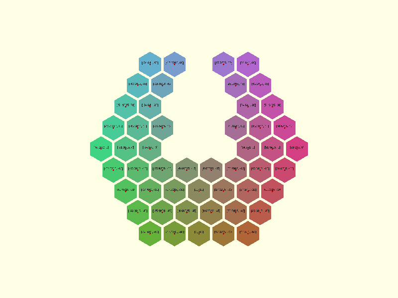
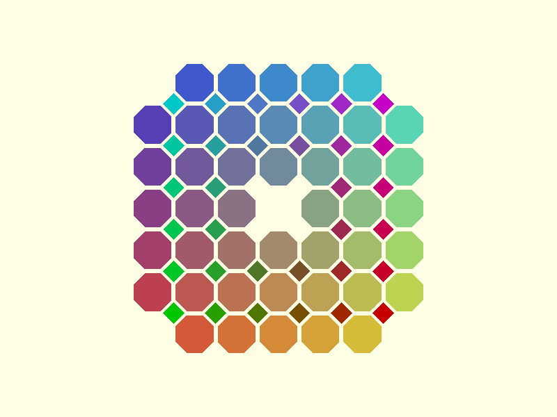

# Tessella


An OpenSCAD library for generating regular and semi-regular tessellations, providing tools to design intricate tiling patterns with polygons.



## Install

Clone the repository into your OpenSCAD library folder (**File → Show Library Folder** in OpenSCAD):

```sh
git clone https://github.com/CameronBrooks11/tessella.git
```

## Quick start

```scad
use <tessella/tess.scad>

// where the tiles go
centers = hexagons_centers_radial(radius = 10, levels = 3);

// the outline of each tile, drawn slightly smaller to leave a gap
vertices = hexagons_vertices(radius = 9, centers = centers);

// draw them
generic_poly(
    vertices = vertices,
    paths = [[0, 1, 2, 3, 4, 5, 0]],
    centers = centers,
    color_scheme = "scheme1",
    extrude = 2
);
```

[Getting started](docs/getting-started.md) continues from here.

## What is in the library

| Tiling    | Vertex configuration | Layouts             |
| --------- | -------------------- | ------------------- |
| Triangles | 3.3.3.3.3.3          | rectangular, radial |
| Squares   | 4.4.4.4              | rectangular, radial |
| Hexagons  | 6.6.6                | rectangular, radial |
| 4.8.8     | 4.8.8                | rectangular         |

Each tiling has functions that return tile centres and tile outlines as lists of points. `filter_center_points()` removes tiles from a pattern, and `generic_poly()` draws the result flat or extruded, with an optional colour gradient. The other seven semi-regular tilings are planned.

## Documentation

The documentation site is at <https://cameronbrooks11.github.io/tessella/>, where the [examples](https://cameronbrooks11.github.io/tessella/examples/) are embedded as 3D models. The same pages are in `docs/`:

- [Getting started](docs/getting-started.md)
- [Usage](docs/usage/index.md): [layouts](docs/usage/layouts.md), [removing tiles](docs/usage/filtering.md) and [rendering](docs/usage/rendering.md)
- [Reference](docs/reference/index.md)
- [Examples](docs/examples/index.md)
- [Theory](docs/theory/index.md)

## Citing

If you use Tessella in published work, cite it with the metadata in [CITATION.cff](CITATION.cff).

## License

[Mozilla Public License 2.0](LICENSE).
