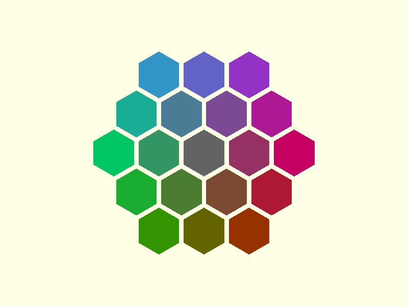

# Getting started

## Install

Clone the repository into your OpenSCAD library folder. In OpenSCAD, **File → Show Library Folder** opens it.

```sh
git clone https://github.com/CameronBrooks11/tessella.git
```

You can also clone it next to your project and import it by relative path. Tessella has no dependencies.

To pin a release, check out its tag:

```sh
git clone --branch v0.1.0 https://github.com/CameronBrooks11/tessella.git
```

Tessella is developed against OpenSCAD 2026.10.15. It uses function literals, which need OpenSCAD 2021.01 or later.

## Import the library

```scad
use <tessella/tess.scad>
```

`tess.scad` is an index file that pulls in every tiling and the utilities. `use` is enough for all the functions and
modules. `include` also works, and additionally brings the library's one top-level variable, `EPSILON`, into your
file.

## A first tessellation

This draws three rings of hexagons around a central one.

```scad
use <tessella/tess.scad>

radius = 10; // centre-to-corner distance of each hexagon
gap = 1;     // how much to shrink each tile

// 1. where the tiles go
centers = hexagons_centers_radial(radius = radius, levels = 3);

// 2. the outline of each tile
vertices = hexagons_vertices(radius = radius - gap, centers = centers);

// 3. draw them
generic_poly(vertices = vertices, paths = [[0, 1, 2, 3, 4, 5, 0]], centers = centers, color_scheme = "scheme1",
             extrude = 2);
```



Three things to notice:

- `centers` is laid out with the full `radius`, and `vertices` is drawn with a smaller one. The difference is what
  leaves a gap between tiles. With the same radius for both, the tiles touch.
- `paths` is the order in which each tile's corners are joined. It is the same for every tile, so it is given once.
- `centers` is passed to `generic_poly()` only so it can colour each tile by its position. Leave out `centers` and
  `color_scheme` and the tiles are drawn in the default colour.

## Remove some tiles

`filter_center_points()` takes a list of centres and a list of points to remove from it. Apply it before computing
the vertices:

```scad
use <tessella/tess.scad>

radius = 10;

all_centers = hexagons_centers_radial(radius = radius, levels = 3);
centers = filter_center_points(all_centers, [[0, 0], [17.3205, 0], [-17.3205, 0]]);

vertices = hexagons_vertices(radius = radius - 1, centers = centers);
generic_poly(vertices = vertices, paths = [[0, 1, 2, 3, 4, 5, 0]], extrude = 2);
```

The coordinates do not have to be exact. `echo(all_centers);` prints them rounded to six significant figures, and a
point copied from that output still matches. [Removing tiles](usage/filtering.md) explains why.

## Next

- [Layouts](usage/layouts.md) describes the rectangular and radial layouts of each tiling.
- [Rendering](usage/rendering.md) covers `generic_poly()`, the colour schemes and extrusion.
- [Examples](examples/index.md) has a complete file for each tiling and layout.
