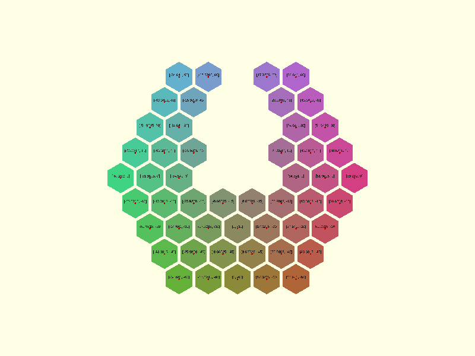

# Tessella


Tessella is an OpenSCAD library for regular and semi-regular tessellations. It computes where the tiles of a pattern
go and what their outlines are, as plain lists of points, and leaves what to do with them to you.



## How it works

A tessellation is built in three steps, and each step is an ordinary OpenSCAD value you can inspect or change.

1. A **centers** function returns the centre point of every tile in a layout, as a list of `[x, y]` points.
2. A **vertices** function turns those centres into one polygon outline per tile.
3. `generic_poly()` draws the outlines, flat or extruded, with an optional colour gradient.

```scad
use <tessella/tess.scad>

centers = hexagons_centers_radial(radius = 10, levels = 3);
vertices = hexagons_vertices(radius = 9, centers = centers);
generic_poly(vertices = vertices, paths = [[0, 1, 2, 3, 4, 5, 0]], extrude = 2);
```

Because the centres are a list, removing tiles is a list operation: `filter_center_points()` drops the centres you
name before the vertices are computed. That is how the gap in the image above was made.

## What is implemented

| Tiling    | Vertex configuration | Layouts             | Reference                                 |
| --------- | -------------------- | ------------------- | ----------------------------------------- |
| Triangles | 3.3.3.3.3.3          | rectangular, radial | [Triangles](reference/triangles.md)       |
| Squares   | 4.4.4.4              | rectangular, radial | [Squares](reference/squares.md)           |
| Hexagons  | 6.6.6                | rectangular, radial | [Hexagons](reference/hexagons.md)         |
| 4.8.8     | 4.8.8                | rectangular         | [4.8.8](reference/tess-4-8-8.md)          |

The other seven semi-regular tilings are planned; [Theory](theory/index.md#status) lists them.

## Where to go next

- [Getting started](getting-started.md) installs the library and builds a first tessellation.
- [Usage](usage/index.md) covers layouts, removing tiles, and rendering.
- [Reference](reference/index.md) lists every function and module, its parameters and its known issues.
- [Examples](examples/index.md) walks through the seven example files in the repository.
- [Theory](theory/index.md) has the geometry behind the hexagon and octagon spacing.

## Citing

If you use Tessella in published work, cite it with the metadata in
[`CITATION.cff`](https://github.com/CameronBrooks11/tessella/blob/main/CITATION.cff). The archived release is
[doi:10.5281/zenodo.23860865](https://doi.org/10.5281/zenodo.23860865).

## License

[Mozilla Public License 2.0](https://github.com/CameronBrooks11/tessella/blob/main/LICENSE).
