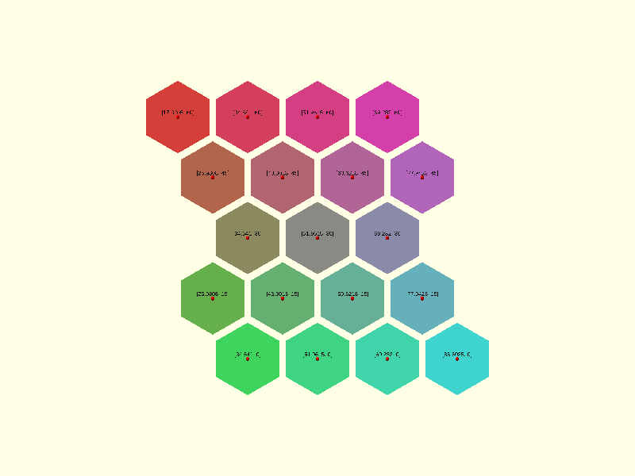
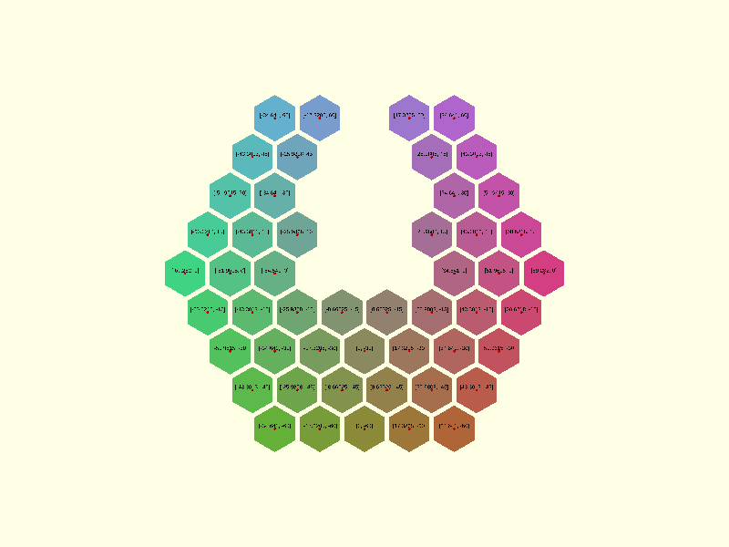

# Hexagons

Defined in `src/regular/hexagons.scad`. Hexagons are sized by `radius`, the distance from the centre to a corner,
which for a regular hexagon equals the edge length. The distance across the flats is `radius * sqrt(3)`.

The layouts place hexagons with a corner pointing up. [Theory](../theory/hexagons.md) derives the spacing.

## hexagons_centers_rect

```scad
hexagons_centers_rect(radius, n, m)
```

Returns the centres of `m` rows of `n` hexagons, the regular 6.6.6 tiling.

| Parameter | Meaning                         |
| --------- | ------------------------------- |
| `radius`  | Centre-to-corner distance       |
| `n`       | Number of hexagons in each row  |
| `m`       | Number of rows                  |

Hexagons in a row are `radius * sqrt(3)` apart. Rows are `radius * 1.5` apart, and odd rows are shifted half a
hexagon toward +X. The first centre is at the origin. The result has `n * m` points.

```scad
use <tessella/tess.scad>

echo(hexagons_centers_rect(10, 3, 2));
// ECHO: [[0, 0], [8.66025, 15], [17.3205, 0], [25.9808, 15], [34.641, 0], [43.3013, 15]]
```



## hexagons_centers_radial

```scad
hexagons_centers_radial(radius, levels)
```

Returns the centres of a hexagon surrounded by complete rings of hexagons.

| Parameter | Meaning                                              |
| --------- | ---------------------------------------------------- |
| `radius`  | Centre-to-corner distance                            |
| `levels`  | Number of rings, counting the central hexagon as one |

The pattern is centred on the origin. The result has `3 * levels^2 - 3 * levels + 1` points: 1, 7, 19, 37, 61 for
levels 1 to 5.

```scad
use <tessella/tess.scad>

echo(hexagons_centers_radial(10, 2));
// ECHO: [[-17.3205, 0], [0, 0], [17.3205, 0], [-8.66025, 15], [8.66025, 15], [-8.66025, -15], [8.66025, -15]]
```



## hexagons_vertices

```scad
hexagons_vertices(radius, centers, angular_offset = 30)
```

Returns the six corners of a hexagon around each centre.

| Parameter        | Meaning                                                           |
| ---------------- | ----------------------------------------------------------------- |
| `radius`         | Centre-to-corner distance of the hexagons drawn                   |
| `centers`        | List of centre points                                             |
| `angular_offset` | Angle of the first corner from +X; 30 puts a corner pointing up   |

Corners are listed anticlockwise. Keep the default `angular_offset` with centres from the two functions above. Another
angle rotates each hexagon in place, and unless the change is a multiple of 60 they no longer fit together.

Pass a `radius` smaller than the one the centres were laid out with to leave a gap. The gap between neighbouring
hexagons is `sqrt(3)` times the difference.

```scad
use <tessella/tess.scad>

echo(hexagons_vertices(10, [[0, 0]]));
// ECHO: [[[8.66025, 5], [0, 10], [-8.66025, 5], [-8.66025, -5], [0, -10], [8.66025, -5]]]
```

Render with `paths = [[0, 1, 2, 3, 4, 5, 0]]`.
