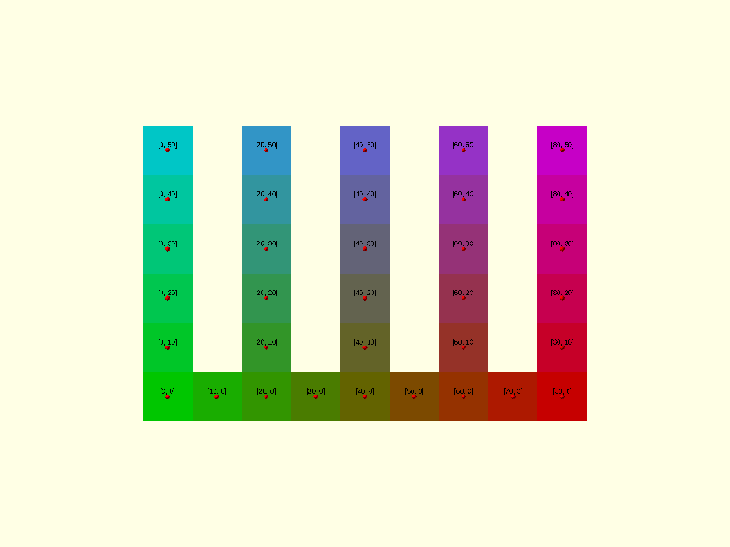
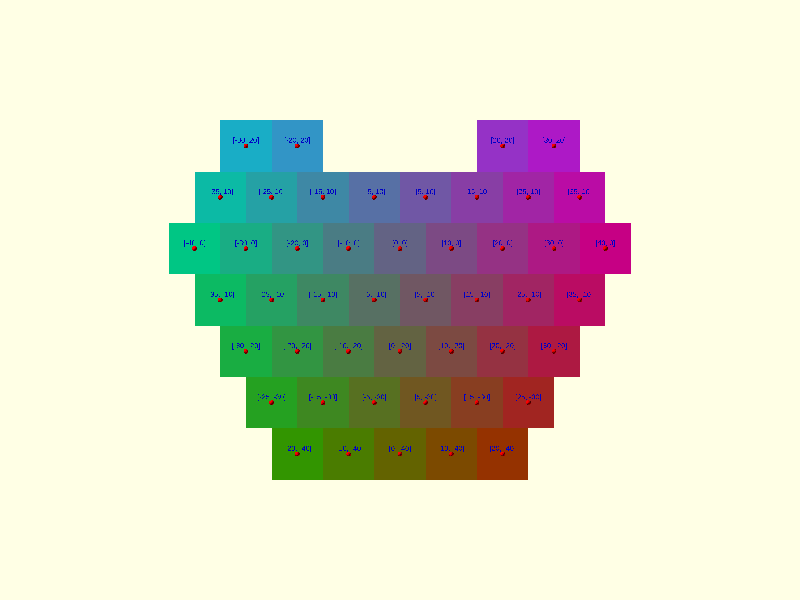

# Squares

Defined in `src/regular/squares.scad`. Squares are sized by `side`, the edge length.

## squares_centers_rect

```scad
squares_centers_rect(side, n, m)
```

Returns the centres of an `n` by `m` grid of squares, the regular 4.4.4.4 tiling.

| Parameter | Meaning                          |
| --------- | -------------------------------- |
| `side`    | Edge length, and the grid pitch  |
| `n`       | Number of squares along X        |
| `m`       | Number of squares along Y        |

The first centre is at the origin and the grid grows along +X and +Y. The result has `n * m` points.

```scad
use <tessella/tess.scad>

echo(squares_centers_rect(10, 3, 2));
// ECHO: [[0, 0], [0, 10], [10, 0], [10, 10], [20, 0], [20, 10]]
```



## squares_centers_radial

```scad
squares_centers_radial(side, levels)
```

Returns the centres of a pattern of centred rows that narrows above and below the middle.

| Parameter | Meaning                                                   |
| --------- | --------------------------------------------------------- |
| `side`    | Edge length                                               |
| `levels`  | Number of rows from the middle row to the top, inclusive  |

The middle row has `2 * levels - 1` squares and is centred on the origin. Each row away from it has one square fewer.
The result has `3 * levels^2 - 3 * levels + 1` points.

Because every row is centred, adjacent rows are offset by half a square. The pattern is staggered like brickwork,
not an edge-to-edge grid.

```scad
use <tessella/tess.scad>

echo(squares_centers_radial(10, 2));
// ECHO: [[-5, -10], [5, -10], [-10, 0], [0, 0], [10, 0], [-5, 10], [5, 10]]
```



## squares_vertices

```scad
squares_vertices(side, centers, angular_offset = 45)
```

Returns the four corners of a square around each centre.

| Parameter        | Meaning                                                          |
| ---------------- | ---------------------------------------------------------------- |
| `side`           | Edge length of the squares drawn                                 |
| `centers`        | List of centre points                                            |
| `angular_offset` | Angle of the first corner from +X; 45 gives axis-aligned squares |

Corners are listed anticlockwise. Pass a `side` smaller than the one the centres were laid out with to leave a gap
between squares; the gap equals the difference.

`angular_offset = 0` gives squares standing on a corner, which is what the [4.8.8](tess-4-8-8.md) tiling needs.

```scad
use <tessella/tess.scad>

echo(squares_vertices(10, [[0, 0]]));
// ECHO: [[[5, 5], [-5, 5], [-5, -5], [5, -5]]]
```

Render with `paths = [[0, 1, 2, 3, 0]]`.
