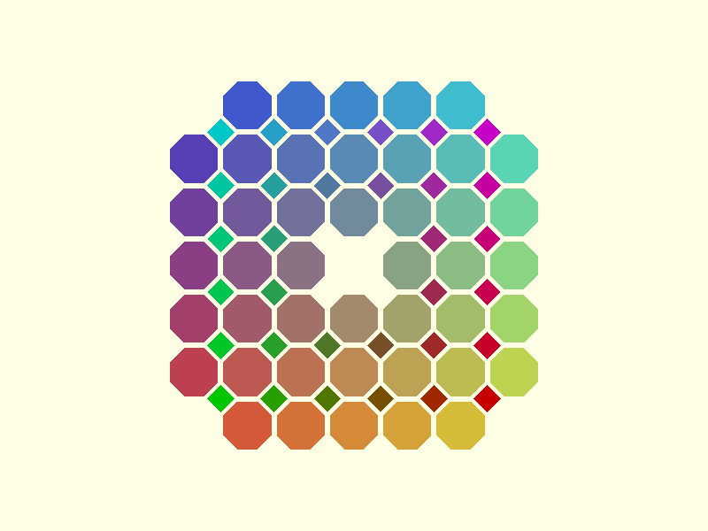

# 4.8.8

Defined in `src/semi_regular/tess_4_8_8.scad`. The 4.8.8 tiling, also called the truncated square tiling, has one
square and two octagons at every vertex.

Everything is sized by `radius`, the distance from an octagon's centre to one of its corners. The octagon's edge
length follows from it, and the squares have the same edge length:

```scad
side_length = (radius * 2) / sqrt(4 + 2 * sqrt(2)); // about 0.765 * radius
```

[Theory](../theory/octagons.md) derives this.



## A complete pattern

```scad
use <tessella/tess.scad>

radius = 10;
n = 4;
m = 3;

oct_centers = octagons_centers_rect(radius, n, m);
sq_centers = squares_8_8_centers_rect(radius, n, m);

side_length = (radius * 2) / sqrt(4 + 2 * sqrt(2));

generic_poly(vertices = octagons_vertices(radius, oct_centers), paths = [[0, 1, 2, 3, 4, 5, 6, 7, 0]],
             centers = oct_centers, color_scheme = "scheme2");

generic_poly(vertices = squares_vertices(side_length, sq_centers, angular_offset = 0), paths = [[0, 1, 2, 3, 0]],
             centers = sq_centers, color_scheme = "scheme1");
```

The squares are drawn with `squares_vertices()` from [Squares](squares.md), with `angular_offset = 0`. The gap
between four octagons is a square standing on a corner, and the default offset of 45 would draw it axis-aligned.

## octagons_centers_rect

```scad
octagons_centers_rect(radius, n, m)
```

Returns the centres of an `n` by `m` grid of octagons.

| Parameter | Meaning                         |
| --------- | ------------------------------- |
| `radius`  | Centre-to-corner distance       |
| `n`       | Number of octagons along X      |
| `m`       | Number of octagons along Y      |

The pitch in both directions is the octagon's width across the flats, `side_length * (1 + sqrt(2))`, which is
`radius * 2 * cos(22.5)`. The first centre is at the origin. The result has `n * m` points.

```scad
use <tessella/tess.scad>

echo(octagons_centers_rect(10, 2, 2));
// ECHO: [[0, 0], [0, 18.4776], [18.4776, 0], [18.4776, 18.4776]]
```

## squares_8_8_centers_rect

```scad
squares_8_8_centers_rect(radius, n, m)
```

Returns the centres of the squares that fill the gaps in an `n` by `m` grid of octagons.

| Parameter | Meaning                                        |
| --------- | ---------------------------------------------- |
| `radius`  | Centre-to-corner distance of the **octagons**  |
| `n`       | Number of octagons along X                     |
| `m`       | Number of octagons along Y                     |

Call it with the same arguments as `octagons_centers_rect()`. Each square sits where four octagons meet, so the
result has `(n - 1) * (m - 1)` points, and is empty when `n` or `m` is 1.

```scad
use <tessella/tess.scad>

echo(squares_8_8_centers_rect(10, 3, 3));
// ECHO: [[9.2388, 9.2388], [9.2388, 27.7164], [27.7164, 9.2388], [27.7164, 27.7164]]
```

## octagons_vertices

```scad
octagons_vertices(radius, centers, angular_offset = 22.5)
```

Returns the eight corners of an octagon around each centre.

| Parameter        | Meaning                                                               |
| ---------------- | --------------------------------------------------------------------- |
| `radius`         | Centre-to-corner distance of the octagons drawn                       |
| `centers`        | List of centre points                                                 |
| `angular_offset` | Angle of the first corner from +X; 22.5 puts flat edges on the axes   |

Corners are listed anticlockwise. Keep the default `angular_offset` with centres from `octagons_centers_rect()`.

Pass a `radius` smaller than the one the centres were laid out with to leave a gap. The gap between neighbouring
octagons is `2 * cos(22.5)`, about 1.848, times the difference. To get the same gap between an octagon and a square,
shrink the squares' `side` by that same 1.848 times the amount you shrink the octagons' `radius`.

Render with `paths = [[0, 1, 2, 3, 4, 5, 6, 7, 0]]`.

### Known issues

- There is no radial layout for this tiling.
- `tess_4_8_8.scad` calls `squares_centers_rect()` but does not import `squares.scad`. Imported on its own, both
  centres functions return `undef` with an `Ignoring unknown function` warning. Import `tess.scad` instead.
- The source comment for `octagons_centers_rect()` documents a `rotate` parameter. The function does not have one.
