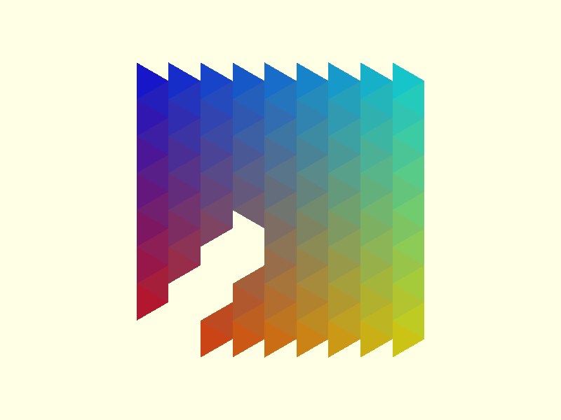

# Triangles

Defined in `src/regular/triangles.scad`. Triangles are equilateral and sized by `side`, the edge length. A centre is
the triangle's centroid.

Neighbouring triangles in the 3.3.3.3.3.3 tiling point in opposite directions, so the vertices function has to work
out an orientation for each centre. That makes triangles the one tiling where the centres function and the vertices
function must be told about each other, through the `rect` parameter.

## triangles_centers_rect

```scad
triangles_centers_rect(side, n, m)
```

Returns the centres of `m` rows of `n` triangles.

| Parameter | Meaning                          |
| --------- | -------------------------------- |
| `side`    | Edge length                      |
| `n`       | Number of triangles in each row  |
| `m`       | Number of rows                   |

The triangles point along X. Triangles in a row are `side * sqrt(3) / 2` apart, rows are `side / 2` apart, and odd
rows are shifted by `side * sqrt(3) / 6` toward +X and point the other way. The first centre is at the origin. The
result has `n * m` points.

```scad
use <tessella/tess.scad>

echo(triangles_centers_rect(10, 3, 2));
// ECHO: [[0, 0], [8.66025, 0], [17.3205, 0], [2.88675, 5], [11.547, 5], [20.2073, 5]]
```



## triangles_centers_radial

```scad
triangles_centers_radial(side, levels)
```

Returns the centres of a pattern that grows outward from a single triangle at the origin.

| Parameter | Meaning                                 |
| --------- | --------------------------------------- |
| `side`    | Edge length                             |
| `levels`  | Size of the pattern; 1 is one triangle  |

Here the triangles point along Y. The result has `1 + 3 * levels * (levels - 1) / 2` points: 1, 4, 10, 19, 31 for
levels 1 to 5. That formula matches the output at every level checked, 1 to 8 and 16.

```scad
use <tessella/tess.scad>

echo(triangles_centers_radial(10, 2));
// ECHO: [[0, 0], [0, -5.7735], [-5, 2.88675], [5, 2.88675]]
```


## triangle_vertices

```scad
triangle_vertices(side, centers, angular_offset = 0, rect = true)
```

Returns the three corners of a triangle around each centre, flipping alternate rows so the triangles interlock.

| Parameter        | Meaning                                                                    |
| ---------------- | -------------------------------------------------------------------------- |
| `side`           | Edge length of the triangles drawn                                         |
| `centers`        | List of centre points                                                      |
| `angular_offset` | Rotation applied to every triangle                                         |
| `rect`           | `true` for centres from `triangles_centers_rect`, `false` for radial ones  |

The two layouts need different arguments:

| Centres from               | `angular_offset` | `rect`  |
| -------------------------- | ---------------- | ------- |
| `triangles_centers_rect`   | `0`              | `true`  |
| `triangles_centers_radial` | `30`             | `false` |

```scad
use <tessella/tess.scad>

side = 10;

rect_centers = triangles_centers_rect(side, 6, 8);
generic_poly(vertices = triangle_vertices(side, rect_centers), paths = [[0, 1, 2, 0]]);

radial_centers = triangles_centers_radial(side, 5);
translate([90, 30, 0])
    generic_poly(vertices = triangle_vertices(side, radial_centers, angular_offset = 30, rect = false),
                 paths = [[0, 1, 2, 0]]);
```

Pass a `side` smaller than the one the centres were laid out with to leave a gap. The gap between neighbouring
triangles is the difference divided by `sqrt(3)`.

Render with `paths = [[0, 1, 2, 0]]`.

### Known issues

- **Orientation depends on absolute position.** The function decides which way a triangle points from its centre's
  X coordinate (`rect = true`) or Y coordinate (`rect = false`), measured from the origin. Centres that have been
  moved since the centres function returned them come out pointing the wrong way. Compute the vertices first and
  move the geometry with `translate()`, as the example above does.
- The source comment documents a parameter named `is_radial`. The parameter is `rect`, with the opposite sense.
