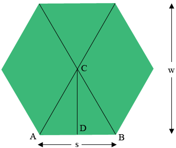

# Hexagon geometry

This derives the spacing used by the hexagon layouts and the number of tiles in the radial one.

## Width and side length

In the diagram, $w$ is the width of the hexagon across its flats and $s$ is its side length.

A regular hexagon is made of six equilateral triangles, such as $ABC$. $D$ is the midpoint of $AB$, so in the right
triangle $CDB$ the angle at $B$ is 60° and

$$
\tan(60^\circ) = \frac{|CD|}{|DB|}
$$

$|CD|$ is half the width and $|DB|$ is half a side. Since $\tan(60^\circ) = \sqrt{3}$,

$$
\sqrt{3} = \frac{w/2}{s/2} = \frac{w}{s}
$$

which gives the width in terms of the side, and the reverse:

$$
w = s\sqrt{3} \qquad s = \frac{w}{\sqrt{3}}
$$

A hexagon 8 units across the flats, for example, has sides of $8/\sqrt{3} \approx 4.62$ units.

The triangles are equilateral, so the distance from the centre to a corner, which the library calls `radius`, equals
the side length $s$.

## Spacing of the centres

The layouts place the hexagons with a corner pointing up, so the flats face left and right.

Neighbours in a row touch along a flat, so their centres are one width apart:

$$
\text{column pitch} = w = \text{radius} \cdot \sqrt{3} = 2 \cdot \text{radius} \cdot \cos(30^\circ)
$$

The next row sits in the notches of the first. Its centres are half a column to the side and one and a half radii
up:

$$
\text{row pitch} = \text{radius} + \text{radius} \cdot \sin(30^\circ) = 1.5 \cdot \text{radius}
$$

These are `offset_step` and `offset_y` in `src/regular/hexagons.scad`. `offset_x` is half the column pitch,
$\text{radius} \cdot \cos(30^\circ)$.

`hexagons_centers_rect()` applies the two pitches directly, shifting odd rows by `offset_x`.

`hexagons_centers_radial()` builds the middle row first. It has $2L - 1$ hexagons for $L$ levels and starts at

$$
dx = -(L - 1) \cdot 2 \cdot \text{offset}_x
$$

so that it is centred on the origin. Each row above it has one hexagon fewer and starts `offset_x` further right, and
the rows below mirror the rows above.

## Growth rate

Let $H(L)$ be the number of hexagons in a radial layout of $L$ levels. One level is the central hexagon:

$$
H(1) = 1
$$

Each further level is a ring around the previous pattern. Ring $L$ has $L - 1$ hexagons along each of its six sides:

$$
H_{\text{added}}(L) = 6(L - 1)
$$

The total is the sum of the rings:

$$
H(L) = 1 + \sum_{i=2}^{L} 6(i - 1)
$$

Using the sum of the first $n$ natural numbers,

$$
\sum_{i=1}^{n} i = \frac{n(n + 1)}{2}
$$

the total becomes

$$
H(L) = 1 + 6 \cdot \frac{(L - 1)L}{2} = 1 + 3L(L - 1)
$$

and so

$$
H(L) = 3L^2 - 3L + 1
$$

The pattern grows quadratically: 1, 7, 19, 37, 61 hexagons for one to five levels.

## References

1. [Hexagon tangent problem](https://mathcentral.uregina.ca/QQ/database/QQ.09.19/h/rob1.html), Math Central,
   University of Regina. The diagram is from this page.
