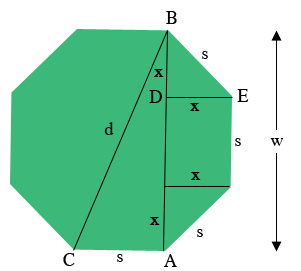
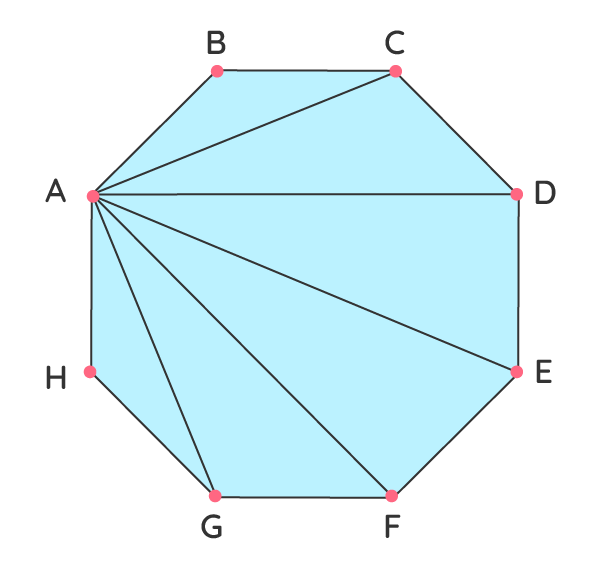

# Octagon geometry

This derives the dimensions of a regular octagon that the 4.8.8 layout is built on.

## Side, width and diagonal

_Diagram courtesy of Penny Nom [1]._

In the diagram $s$ is the side length, $w$ is the width across the flats, and $d$ is the longest diagonal, from one
corner to the opposite one.

### Segment x

Extending the sides of the octagon cuts a right isosceles triangle off each corner, such as $EBD$. Its two equal legs
are the segments $x$ and its hypotenuse is a side of the octagon. By the Pythagorean theorem:

$$
s^2 = 2x^2 \qquad x = \frac{s}{\sqrt{2}}
$$

### Width w

The width runs from one flat to the opposite one. It is a side plus a segment $x$ at each end:

$$
w = s + 2x = s + \frac{2s}{\sqrt{2}} = s(1 + \sqrt{2})
$$

### Diagonal d

$ABC$ is a right triangle with the right angle at $A$. Its legs are the width, $AB = w$, and a side, $AC = s$.
Its hypotenuse is the diagonal:

$$
d^2 = s^2 + w^2 = s^2 + s^2(1 + \sqrt{2})^2
$$

$$
d = s\sqrt{4 + 2\sqrt{2}}
$$

### Summary

| Quantity   | In terms of the side                    |
| ---------- | --------------------------------------- |
| Segment    | $x = s / \sqrt{2}$                      |
| Width      | $w = s(1 + \sqrt{2})$                   |
| Diagonal   | $d = s\sqrt{4 + 2\sqrt{2}}$             |

## How the library uses them

The library sizes an octagon by `radius`, the distance from the centre to a corner. The diagonal is twice that,
which gives the side length that appears in `src/semi_regular/tess_4_8_8.scad`:

$$
s = \frac{2 \cdot \text{radius}}{\sqrt{4 + 2\sqrt{2}}}
$$

Neighbouring octagons in the 4.8.8 tiling touch along a flat, so their centres are one width apart. That is the grid
pitch, `total_width` in the source:

$$
w = s(1 + \sqrt{2})
$$

The squares have the same side length $s$ as the octagons. Each sits where four octagons meet, half a pitch along
both axes from the octagon centres, and stands on a corner.

## Chord across two sides

A rotated octagon layout would need two more lengths. The library does not use them yet.

The chord $AC$ joins two corners that are two sides apart. In triangle $ABC$ the sides $AB$ and $BC$ are both $s$,
and the angle between them is the octagon's interior angle, 135°. By the law of cosines:

$$
AC^2 = 2s^2 - 2s^2\cos(135^\circ)
$$

Since $\cos(135^\circ) = -\frac{\sqrt{2}}{2}$,

$$
AC = s\sqrt{2 + \sqrt{2}}
$$

Let $M$ be the midpoint of $AC$. $BM$ is perpendicular to $AC$, and in the right triangle $ABM$:

$$
BM^2 + \left(\frac{AC}{2}\right)^2 = s^2
$$

$$
BM = \sqrt{s^2 - \frac{s^2(2 + \sqrt{2})}{4}} = \frac{s}{2}\sqrt{2 - \sqrt{2}}
$$

So the chord is $y = s\sqrt{2 + \sqrt{2}}$ and the height of the corner above it is
$h = \frac{s}{2}\sqrt{2 - \sqrt{2}}$.

## References

1. [Quandaries and queries](http://mathcentral.uregina.ca/QQ/database/QQ.09.20/h/sue2.html), Math Central, University
   of Regina.
2. [Octagon](https://www.cuemath.com/geometry/octagon/), Cuemath.
