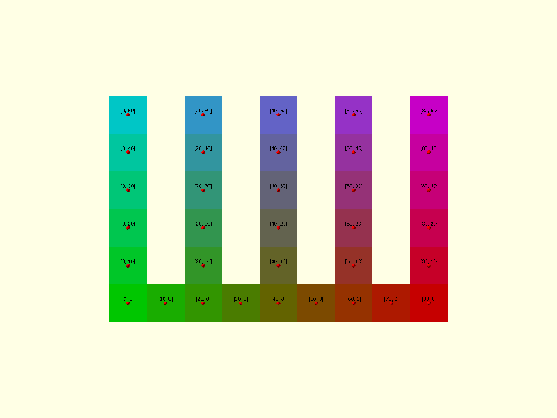
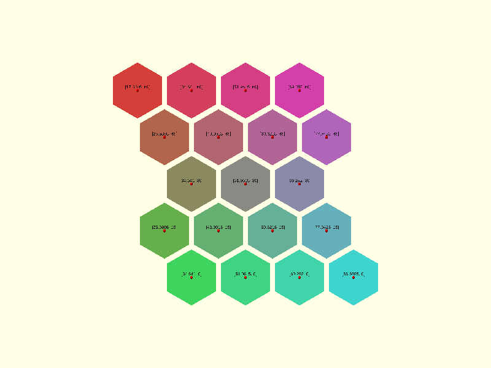
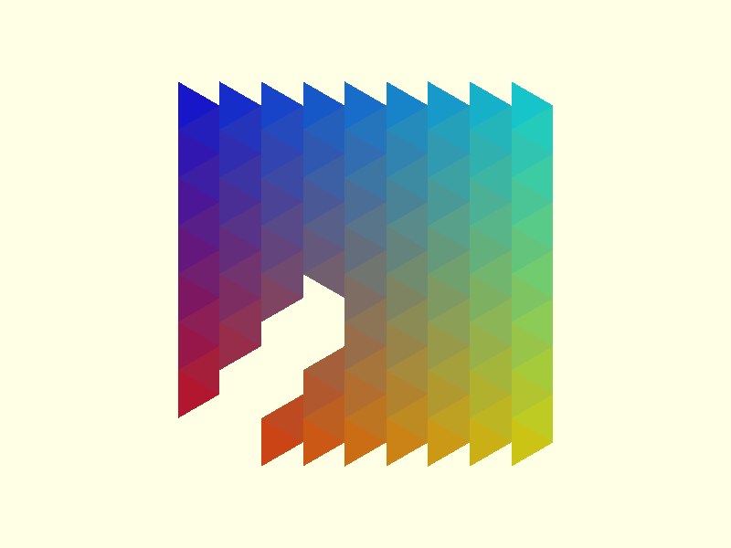
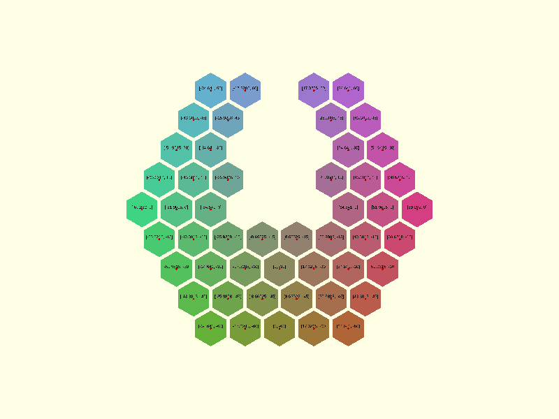
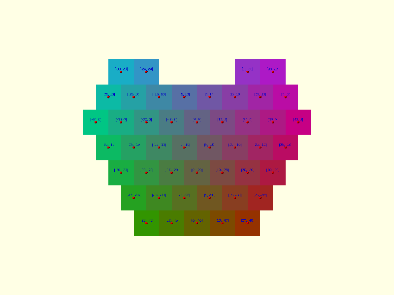

# Layouts

A layout is the set of tile centres. The regular tilings each have two: rectangular, sized by a column count `n` and
a row count `m`, and radial, sized by a number of `levels` out from a central tile.

## Rectangular

| Function                                | Tiles | Column pitch (X)   | Row pitch (Y)   | Stagger                              |
| --------------------------------------- | ----- | ------------------ | --------------- | ------------------------------------ |
| `squares_centers_rect(side, n, m)`      | n × m | `side`             | `side`          | none                                 |
| `hexagons_centers_rect(radius, n, m)`   | n × m | `radius * sqrt(3)` | `radius * 1.5`  | odd rows shifted half a column       |
| `triangles_centers_rect(side, n, m)`    | n × m | `side * sqrt(3)/2` | `side / 2`      | odd rows shifted by `side * sqrt(3)/6` |
| `octagons_centers_rect(radius, n, m)`   | n × m | `radius * 2 * cos(22.5)` | same as X | none                                 |

Rows are numbered from zero, so the first row is even.




In the triangle layout the triangles point along X, alternately left and right, so a "row" is a horizontal band half
a side apart. `n = 9, m = 15` with `side = 20` covers about 160 × 160 units.



## Radial

| Function                                  | Tiles for `levels = L`  | L = 1, 2, 3, 4, 5  |
| ----------------------------------------- | ----------------------- | ------------------ |
| `hexagons_centers_radial(radius, levels)` | 3L² − 3L + 1            | 1, 7, 19, 37, 61   |
| `squares_centers_radial(side, levels)`    | 3L² − 3L + 1            | 1, 7, 19, 37, 61   |
| `triangles_centers_radial(side, levels)`  | 1 + 3L(L − 1)/2         | 1, 4, 10, 19, 31   |

`levels = 1` is a single tile at the origin. The hexagon count is derived in [Theory](../theory/hexagons.md#growth-rate).

The hexagon layout is a hexagon of hexagons: each level adds a complete ring.



The square layout has the same row structure as the hexagon one. The middle row has `2 * levels - 1` squares, each
row above and below has one fewer, and every row is centred. Adjacent rows are therefore offset by half a square,
like courses of brick. It is not the edge-to-edge 4.4.4.4 tiling; use `squares_centers_rect()` for that.



The triangle layout grows as a hexagon with alternate sides shorter.


Radial triangle centres need `rect = false` when they are turned into vertices. See
[`triangle_vertices()`](../reference/triangles.md#triangle_vertices).

## Moving a layout

The centres are plain points, so you can transform them yourself. For most tilings it does not matter whether you
move the centres or the finished geometry.

Triangles are the exception. `triangle_vertices()` decides which way each triangle points from the absolute
coordinates of its centre, so centres that have been shifted come out with the wrong orientation. Compute the
vertices from the centres as the library returned them, then move the result with `translate()`:

```scad
use <tessella/tess.scad>

centers = triangles_centers_rect(side = 10, n = 6, m = 8);
vertices = triangle_vertices(side = 10, centers = centers);

translate([30, 15, 0])
    generic_poly(vertices = vertices, paths = [[0, 1, 2, 0]]);
```

## 4.8.8

The 4.8.8 tiling has two kinds of tile, so it has two centres functions that are called with the same arguments:

```scad
use <tessella/tess.scad>

radius = 10;
// 4 × 3 octagons
oct_centers = octagons_centers_rect(radius, 4, 3);

// the 3 × 2 squares between them
sq_centers = squares_8_8_centers_rect(radius, 4, 3);
```

`n` and `m` count octagons. The squares fill the gaps between four octagons, so there are `(n - 1) × (m - 1)` of
them. [4.8.8](../reference/tess-4-8-8.md) shows the full pattern.
